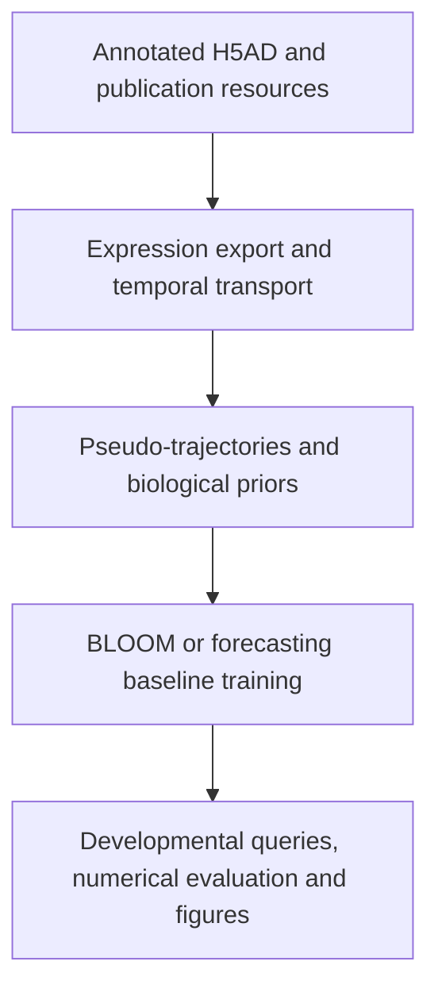

# BLOOM

### Biologically Informed Flow Matching for Transcriptomic Virtual Embryo Modeling

Conditional generation of developmental cell populations from ordered expression histories and biological priors.

[Overview](#overview) · [Installation](#installation) · [Data preparation](#data-preparation) · [Training](#training) · [Evaluation](#evaluation-in-manuscript-order) · [Figures](#figure-generation) · [Checkpoints](#checkpoints-and-reproducibility)

---

## Overview

BLOOM models developmental transcriptomic populations at requested stages. It combines temporal population context, inferred cell correspondences, and developmental, anatomical, programme and regulatory knowledge in a conditional flow-matching model.

The two BLOOM configurations live together in **[`src/bloom/models/bloom.py`](src/bloom/models/bloom.py)**:

- **Unidirectional BLOOM:** one trained developmental direction per checkpoint; forward and reverse models can be trained with the same launcher.
- **Bidirectional BLOOM:** a shared model with developmental-direction conditioning.

The paper's 22 forecasting baselines use one shared factory and conditioning interface in **[`src/bloom/models/transformer.py`](src/bloom/models/transformer.py)**. Their original architectures are obtained through a separate, documented Time-Series-Library **[`THUML/Time-Series-Library`](https://github.com/thuml/Time-Series-Library)**.

## Workflow

| Manuscript stage | Repository workflow | Main entry point |
| --- | --- | --- |
| Results 2.1: model and biological knowledge | Expression export, moscot, pseudo-trajectories, GRN and publication-derived priors | `python -m bloom.preprocessing` |
| Results 2.2–2.3: measured expression and genes | Measured prediction exports and numerical metrics; population and gene views | `python -m bloom.evaluation`, figure group `measured` |
| Results 2.4–2.5: states, programmes and regulation | Classifier diagnostics, biological summaries, marker, composition, programme and regulatory-association views | Evaluation `classifier` / `biology-report`; figure group `programmes` |
| Results 2.6–2.7: reverse and temporal extension | Earlier-stage reconstruction, interpolation, recursive history and future | Evaluation tasks `reverse`, `interpolation`, `history`, `future`; figure group `temporal` |
| Results 2.8: single-gene perturbation | Source-history expression edits and predicted molecular responses | Evaluation task and figure group `perturbation` |

## Repository guide

| Location | Purpose |
| --- | --- |
| [`src/bloom/preprocessing/`](src/bloom/preprocessing) | H5AD export, temporal transport, pseudo-trajectories, GRN and author-prior preparation |
| [`src/bloom/models/bloom.py`](src/bloom/models/bloom.py) | Both BLOOM configurations and their shared generative components |
| [`src/bloom/models/transformer.py`](src/bloom/models/transformer.py) | Registry, configuration factory and common interface for the 22 baselines |
| [`src/bloom/training/`](src/bloom/training) | Portable training CLI and retained checkpoint-compatible training routines |
