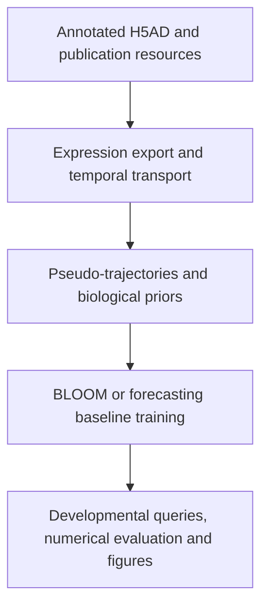

<div align="center">


# BLOOM

### Biologically Informed Flow Matching for Transcriptomic Virtual Embryo Modeling

Conditional generation of developmental cell populations from ordered expression histories and biological priors.

[](pyproject.toml)
[](src/bloom/models/bloom.py)
[](scripts/train)
[](checkpoints/README.md)

[Overview](#overview) · [Installation](#installation) · [Data preparation](#data-preparation) · [Training](#training) · [Evaluation](#evaluation-in-manuscript-order) · [Figures](#figure-generation) · [Checkpoints](#checkpoints-and-reproducibility)

</div>

---

## Overview

BLOOM models developmental transcriptomic populations at requested stages. It combines temporal population context, inferred cell correspondences, and developmental, anatomical, programme and regulatory knowledge in a conditional flow-matching model.

The two BLOOM configurations live together in **[`src/bloom/models/bloom.py`](src/bloom/models/bloom.py)**:

- **Unidirectional BLOOM:** one trained developmental direction per checkpoint; forward and reverse models can be trained with the same launcher.
- **Bidirectional BLOOM:** a shared model with developmental-direction conditioning.

The paper's 22 forecasting baselines use one shared factory and conditioning interface in **[`src/bloom/models/transformer.py`](src/bloom/models/transformer.py)**. Their original architectures are obtained through a separate, documented Time-Series-Library **[`THUML/Time-Series-Library`](https://github.com/thuml/Time-Series-Library)**.

## Workflow



| Manuscript stage | Repository workflow | Main entry point |
| --- | --- | --- |
| Results 2.1: model and biological knowledge | Expression export, moscot, pseudo-trajectories, GRN and publication-derived priors | `python -m bloom.preprocessing` |
| Results 2.2–2.3: measured expression and genes | Measured prediction exports and numerical metrics; population and gene views | `python -m bloom.evaluation`, figure group `measured` |
| Results 2.4–2.5: states, programmes and regulation | Classifier diagnostics, biological summaries, marker, composition, programme and regulatory-association views | Evaluation `classifier` / `biology-report`; figure group `programmes` |
| Results 2.6–2.7: reverse and temporal extension | Earlier-stage reconstruction, interpolation, recursive history and future | Evaluation tasks `reverse`, `interpolation`, `history`, `future`; figure group `temporal` |
| Results 2.8: single-gene perturbation | Source-history expression edits and predicted molecular responses | Evaluation task and figure group `perturbation` |

## Repository guide

| Location | Purpose |
| --- | --- |
| [`src/bloom/preprocessing/`](src/bloom/preprocessing) | H5AD export, temporal transport, pseudo-trajectories, GRN and author-prior preparation |
| [`src/bloom/models/bloom.py`](src/bloom/models/bloom.py) | Both BLOOM configurations and their shared generative components |
| [`src/bloom/models/transformer.py`](src/bloom/models/transformer.py) | Registry, configuration factory and common interface for the 22 baselines |
| [`src/bloom/training/`](src/bloom/training) | Portable training CLI and retained checkpoint-compatible training routines |
| [`scripts/train/`](scripts/train) | Exactly 24 model-specific `.sh` launchers, defaulting to author-derived genes |
| [`src/bloom/evaluation/`](src/bloom/evaluation) | Checkpoint export, developmental queries, numerical metrics and data-contract validation |
| [`src/bloom/figures/`](src/bloom/figures) | Four manuscript figure groups and benchmark radar rendering |

## Installation

### 1. Create an environment

Run commands from the repository root. Use Python 3.12 for the tested release environment. The core package supports Python 3.10+, while optional workflows also depend on their selected third-party versions.

```bash
git clone https://github.com/tracy666/BLOOM.git
cd BLOOM
python3 -m venv .venv
source .venv/bin/activate
python -m pip install --upgrade pip
```

Install the PyTorch build appropriate for your CPU or CUDA environment, then install the workflows you need:

```bash
python -m pip install -e ".[train,analysis,preprocess]"
export BLOOM_PYTHON="$(pwd)/.venv/bin/python"

python -m bloom --help
python -m bloom.training --help
```

The same workflows are also available as `bloom preprocess`, `bloom train`, `bloom evaluate` and `bloom figures`. Help and recipe inspection do not load the expression matrices or start training.

### 2. Add optional preparation dependencies

Temporal optimal transport and GRN inference have separate dependency groups:

```bash
python -m pip install -e ".[ot]"
```

For pySCENIC/Arboreto, use the dedicated environment described in [the preprocessing guide](docs/preprocessing.md), especially when retaining an existing working GRN environment. The `grn` extra lists the required Python tools. The prenatal R graph converter additionally needs R and its source-resource dependencies.

### 3. Prepare the baseline implementations

```bash
bash scripts/setup_timeseries_library.sh --python "$BLOOM_PYTHON"
export BLOOM_TSL_ROOT="$(pwd)/external/Time-Series-Library"
```

This obtains the documented compatibility checkout of the original upstream library. Use `--skip-install` to fetch source without changing an existing environment. A compatible existing checkout can instead be supplied with `--tsl-root` or `BLOOM_TSL_ROOT`.

The historical upstream commit used for the manuscript training runs was not included in the source archive. The release's tested compatibility pin is recorded explicitly in [the baseline dependency guide](docs/transformer_dependency.md). Mamba additionally needs its compatible `mamba_ssm`/CUDA environment; the other 21 model interfaces were exercised on CPU.

## Datasets

All three manuscript datasets are mouse. Download their expression data, annotations and relevant publication resources from the original providers.

| Public key | Dataset | Author-derived genes | Data access |
| --- | --- | ---: | --- |
| `prenatal` | Mouse gastrula-to-birth atlas, Qiu et al., Nature 2024 | 70 | [Atlas portal](https://omg.gs.washington.edu/) · [GSE228590](https://www.ncbi.nlm.nih.gov/geo/query/acc.cgi?acc=GSE228590) · [Publication](https://doi.org/10.1038/s41586-024-07069-w) |
| `cortex` | Developing mouse visual cortex, Gao et al., Nature 2025 | 100 | [Allen data access](https://alleninstitute.github.io/abc_atlas_access/descriptions/Dev-Mouse-Vis-Cortex-10X.html) · [Publication](https://doi.org/10.1038/s41586-025-09644-1) |
| `sted` | STED-EC endothelial developmental atlas, Lin et al., Cell 2026 | 135 | [OMIX007369](https://ngdc.cncb.ac.cn/omix/release/OMIX007369) · [Publication](https://doi.org/10.1016/j.cell.2026.01.002) |
